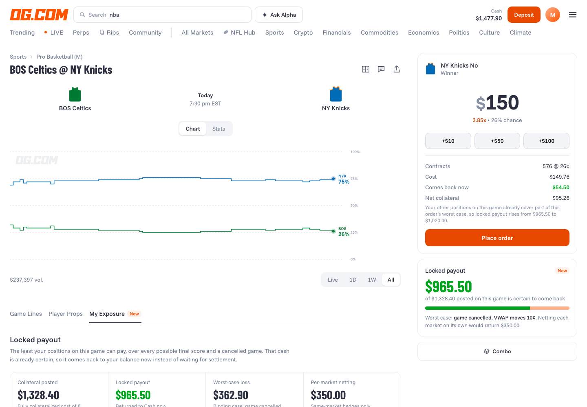

# Locked Payout for OG.com

**Live demo:** https://mohith26.github.io/og-locked-payout/

An unofficial concept feature for [OG.com](https://og.com) prediction markets: **return collateral the moment a set of positions is guaranteed to pay**, across every market on a game at once (winner, spread ladder, total ladder and same-game combos), not just inside one market.

OG's event contracts are fully collateralized: buying 400 NY Knicks Yes at 75¢ posts $300 until settlement. But a trader (or a market maker quoting both sides of a ladder) often holds positions where *some* payout is certain whatever happens. That certain payout is cash the clearinghouse will pay anyway, so it can come back to the account now.



## What the demo shows

- **My Exposure tab** on a game page (next to Game Lines / Player Props): locked payout, worst-case loss, and a heatmap of the portfolio's payout over every final score, with the worst region outlined.
- **Trade slip**: for any order, how much of its cost comes back immediately because existing positions already cover its worst case (click Yes/No on any line in *Game Lines*).
- **Cancellation control**: OG settles a cancelled event at each market's trailing one-week VWAP. The guarantee holds for any VWAP inside a band you choose around today's.
- **Clearing view**: the same computation across a synthetic book of 400 accounts on 10 NBA games, compared with netting each market on its own (what single-event collateral return does today).

On the synthetic book with a 10¢ VWAP band: $1,177,721 posted, $309,513 returned by per-market netting, **$406,277 returned by joint netting (31% more)**. Numbers are recomputed live in the page from `data.js`.

## How it works (`lockedpayout.js`)

Write `m = home - away` and `t = home + away`. Every leg is a half-plane test: winner is `m > 0`, a home spread of `L` is `m + L > 0`, an over is `t > L`. So a portfolio's payout is piecewise constant on a grid cut by the lines it holds.

1. **Exact candidate set.** Truth values only change at line breakpoints, so a few integers either side of every breakpoint represent every region of the `(m, t)` plane.
2. **Feasibility.** Basketball has no ties (`m != 0`), scores are non-negative (`t >= |m|`), and `m` and `t` must share parity (the home score `(t + m) / 2` is an integer). Parity matters: a one-point spread window and a one-point total window can be jointly impossible, which raises the guarantee.
3. **Cancellation.** A cancelled game settles Yes at VWAP `v` and No at `1 - v`, independently per market row. Payout is linear in `v`, so the worst case sits at an end of the allowed band. Combos touching a cancelled game are valued at 0 (conservative).
4. **Outcome classes and branch and bound.** Outcomes with identical leg truth vectors are merged per game. Games are coupled only by cross-game combos, so an exact branch and bound over per-game classes (bounded below by each remaining game's cheapest class) finds the joint minimum.
5. **Locked payout** = that minimum. **Baseline** = the same computation run separately on each market group (winner / spread / total) with combos ignored, which is what per-event netting can see.

## Tests

```
node --test test/*.test.js
```

12 tests, including a brute-force check against every final score from 60 to 170 points for 60 random portfolios, the parity case, cross-game combos, the VWAP band, and incremental (per-order) returns.

## Data

`node gen_data.js > data.js` (seed 20261112). Prices come from normal models of margin and total; accounts are a mix of retail (single Yes positions and combos), hedgers (middles, winner vs spread) and market makers (two-sided ladder fills and short combos). All synthetic.

## Honest limitations

- Only half-point lines; push settlement on whole-number lines is not modeled.
- Basketball only (no ties). NFL ties and soccer three-way outcomes need a different feasibility set.
- Combos with a cancelled leg are valued at 0 instead of OG's actual leg-void rule, so the guarantee is conservative there.
- Returned collateral means a position can't be closed without re-posting it; the UI would need the same "sale may require collateral" guard other venues use.
- Fees are ignored.
- The logged-in header and the My Exposure tab are my design in OG's visual language; I don't have a logged-in reference.

## Novelty note

I checked OG's help center (Portfolio, Combo, Closing a position, Fees & limits, Market types, Settlement, Perps margin) and recent OG/Crypto.com announcements and CFTC filings: OG event contracts are fully collateralized and I found no collateral return or cross-market netting. Kalshi ships collateral return for mutually exclusive and directional (ladder) markets, but its API docs say netting applies within a single event. Joint netting across winner, spread, total and combo markets on a shared score space, with OG's VWAP cancellation rule, is the new part.

---
Unofficial concept demo by Mohith Gajjela. Not affiliated with OG.com. Synthetic data.
